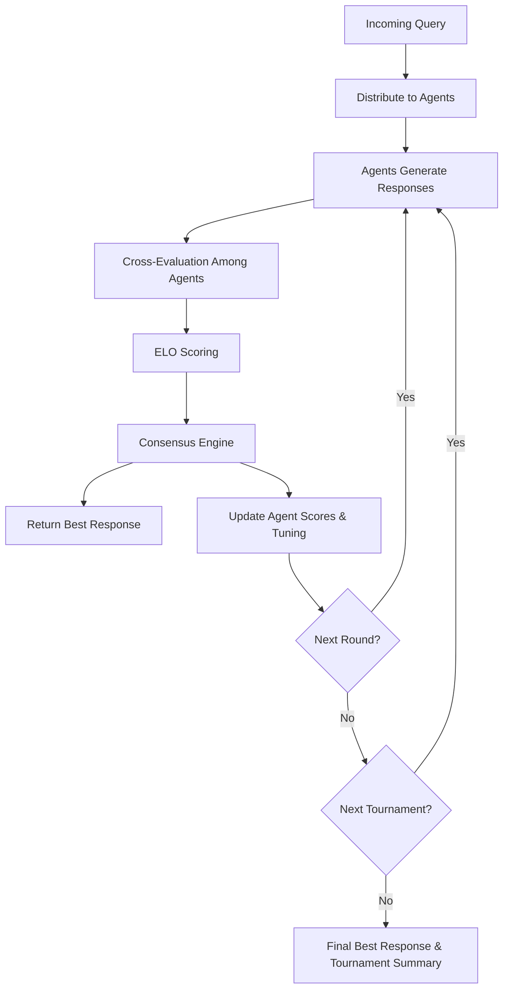

# ART (Adaptive Response Tuning) Framework

[](https://python.org/)
[](https://fastapi.tiangolo.com/)
[](LICENSE)

## 🚀 Overview

**ART (Adaptive Response Tuning)** is a high-performance, multi-agent framework designed to optimize outputs from Large Language Models (LLMs) via **tournament-style ELO ranking** and iterative reasoning.

ART enables developers to:

- Run multiple LLM agents in parallel
- Evaluate and rank responses using ELO scoring
- Generate consensus from multiple expert perspectives
- Continuously improve response quality through cross-evaluation

## 🎯 Key Features

### Multi-Agent Reasoning

- Multiple LLM agents generate independent responses
- Cross-evaluation with structured critique strategies
- Context-aware reasoning across multiple rounds
- Performance tracking and metrics per agent

### Tournament-Style ELO Ranking

- Configurable number of tournaments and rounds
- ELO-based scoring with adjustable K-factor
- Support for draws and partial wins
- Dynamic leaderboards and rankings

### Consensus Generation

- Multiple fusion strategies:
  - Weighted Voting
  - Top Response Selection
  - Contextual Aggregation
  - Hybrid Synthesis
- Confidence-weighted responses
- Agent agreement metrics

### RESTful API

- Submit queries with custom configurations
- Real-time tournament monitoring
- Agent management endpoints
- Comprehensive metrics and logging

## 📦 Installation

### Prerequisites

- Python 3.10+
- PostgreSQL 14+ (optional, for persistence)
- Redis (optional, for caching)

### Quick Start

```bash
# Clone the repository
git clone https://github.com/OmerJauhar/ART.git
cd ART

# Create virtual environment
python -m venv venv
source venv/bin/activate  # On Windows: venv\Scripts\activate

# Install dependencies
pip install -r requirements.txt

# Run the API server
python -m art_framework

# API available at: http://localhost:8000
# Swagger docs at: http://localhost:8000/docs
```

### Using Docker

```bash
# Build and run all services
docker-compose up -d

# Access the API
curl http://localhost:8000/health
```

## 🔧 Configuration

Configure via environment variables (prefix: `ART_`):

| Variable               | Default         | Description       |
| ---------------------- | --------------- | ----------------- |
| `ART_HOST`             | `0.0.0.0`       | API host          |
| `ART_PORT`             | `8000`          | API port          |
| `ART_DEBUG`            | `false`         | Debug mode        |
| `ART_LOG_LEVEL`        | `INFO`          | Logging level     |
| `ART_OPENAI_API_KEY`   | -               | OpenAI API key    |
| `ART_DEFAULT_MODEL`    | `gpt-3.5-turbo` | Default LLM model |
| `ART_DEFAULT_K_FACTOR` | `32.0`          | ELO K-factor      |

## 📚 API Reference

### Health & Metrics

```bash
# Health check
GET /health

# System metrics
GET /metrics
```

### Queries

```bash
# Submit a query
POST /queries
{
  "content": "What is machine learning?",
  "config": {
    "num_tournaments": 1,
    "rounds_per_tournament": 3
  }
}

# Get query result
GET /queries/{query_id}

# List all queries
GET /queries?status=completed&limit=10
```

### Tournaments

```bash
# Run tournament directly
POST /tournaments?query=Your+question+here

# Get tournament details
GET /tournaments/{tournament_id}

# List tournament history
GET /tournaments
```

### Agents

```bash
# Register new agent
POST /agents
{
  "name": "GPT-4-Agent",
  "model_name": "gpt-4",
  "api_key": "sk-...",
  "temperature": 0.7
}

# List all agents
GET /agents

# Get agent details
GET /agents/{agent_id}

# Remove agent
DELETE /agents/{agent_id}
```

### Leaderboard

```bash
# Get current leaderboard
GET /leaderboard
```

### Configuration

```bash
# Get current config
GET /config

# Update config
PUT /config
{
  "num_tournaments": 2,
  "rounds_per_tournament": 5,
  "k_factor": 24.0
}
```

## 🏗️ Architecture

```
ART-Framework/
├── art_framework/
│   ├── agents/           # LLM agent implementations
│   │   ├── base.py       # Abstract base agent
│   │   ├── llm_agent.py  # Real LLM agent
│   │   └── mock_agent.py # Mock agent for testing
│   ├── tournament/       # Tournament engine
│   │   ├── engine.py     # Tournament orchestration
│   │   └── elo.py        # ELO calculator
│   ├── consensus/        # Consensus generation
│   │   └── engine.py     # Fusion strategies
│   ├── api/              # FastAPI application
│   │   ├── app.py        # Application factory
│   │   └── routes.py     # API endpoints
│   ├── data/             # Data models
│   │   └── models.py     # Pydantic schemas
│   └── utils/            # Utilities
│       ├── config.py     # Configuration
│       └── logging.py    # Logging setup
├── tests/                # Unit tests
├── Dockerfile
├── docker-compose.yml
└── requirements.txt
```

## 🧪 Testing

```bash
# Run all tests
pytest

# Run with coverage
pytest --cov=art_framework

# Run specific test file
pytest tests/test_elo.py -v
```

## 📊 Tournament Flow



## 🔬 Research

Paper: [arXiv:2512.00617](https://arxiv.org/abs/2512.00617)

The paper's experiments used simulated (mock) agents with fixed quality parameters, not real
language models. The real-model rerun is in the pilot section below.

## 🔁 Changes since the paper (v1.0-paper)

- Temperature 0 is now respected instead of being replaced by the default.
- Token usage and cost are tracked per call and per agent.
- The revision prompt now includes the original question.
- Unparseable critiques now fail loudly instead of defaulting to a score of 70.
- Response confidence now comes from peer scores instead of a hardcoded value.
- Revised answers are now carried into the next round and re-scored; in v1.0-paper each round
  regenerated fresh answers, so revisions never affected scores or ELO.

## Real-model pilot (October 2026)

The paper's experiments used simulated agents. In October 2026 I reran ART on four real models (DeepSeek V4 Pro, Gemini 3.8 Flash, Claude Sonnet 5.5 and GPT-6.1, via OpenRouter) on 50 LAB-Bench questions (SeqQA and ProtocolQA: 20 calibration, 30 test), against nine baselines. One round of full peer critique matched majority vote (0.900) at 4.7× the cost. ART's ratings, reused as a label-free router fitted on the calibration questions, also scored 0.900 at $0.009 per question, under a tenth of ART's cost. Fusion with a synthesizer scored highest (0.933). With 30 test questions, none of these differences is statistically significant.

Test split, 30 questions (`art_r1` is one round of ART; `elo_router` sends each question to the
model with the top ART rating for its subset):

| method | accuracy [95% CI] | $ per question |
|---|---|---|
| single:deepseek-v4-pro | 0.733 [0.567, 0.867] | 0.0015 |
| single:gemini-3.8-flash | 0.833 [0.700, 0.967] | 0.0044 |
| single:claude-sonnet-5.5 | 0.867 [0.733, 0.967] | 0.0106 |
| single:gpt-6.1-sol | 0.867 [0.733, 0.967] | 0.0057 |
| majority_vote | 0.900 [0.767, 1.000] | 0.0223 |
| art_r1 | 0.900 [0.800, 1.000] | 0.1045 |
| judge | 0.867 [0.733, 0.967] | 0.0341 |
| fusion | 0.933 [0.833, 1.000] | 0.0255 |
| elo_router | 0.900 [0.800, 1.000] | 0.0092 |
| best_single_calibration | 0.833 [0.700, 0.967] | 0.0044 |
| best_single_oracle | 0.867 [0.733, 0.967] | 0.0106 |
| jev_pick | 0.900 [0.800, 1.000] | 0.0226 |
| cascade_llm | 0.867 [0.733, 0.967] | 0.0531 |
| cascade_jev | 0.867 [0.733, 0.967] | 0.0509 |


Reproduce (the run makes real OpenRouter calls unless they are already in the local cache; see
[experiments/pilot/README.md](experiments/pilot/README.md)):

```bash
pip install -e ".[dev]" pandas pyarrow matplotlib pyyaml
echo 'OPENROUTER_API_KEY=sk-or-...' > experiments/pilot/.env   # gitignored

FLAGS="--subsets SeqQA,ProtocolQA --test-per-subset 15 --skip-methods art_r2"
python -m experiments.pilot.run --prepare-data                              # LAB-Bench at the pinned commit
python -m experiments.pilot.run --run-name pilot-v1 $FLAGS --estimate-only  # projected cost, no API call
python -m experiments.pilot.run --run-name pilot-v1 $FLAGS --max-usd 7.0    # the run
python -m experiments.pilot.publish --run-name pilot-v1                     # shareable results
```

Results, config, per-question scores and plots:
[experiments/pilot/published/pilot-v1/](experiments/pilot/published/pilot-v1/).

## 📝 Example Usage

```python
import asyncio
from art_framework.agents import AgentConfig, MockAgent
from art_framework.tournament import TournamentEngine, TournamentConfig

async def main():
    # Create agents
    agents = [
        MockAgent(AgentConfig(name="Alpha", model_name="gpt-4"), response_quality=0.85),
        MockAgent(AgentConfig(name="Beta", model_name="claude"), response_quality=0.80),
        MockAgent(AgentConfig(name="Gamma", model_name="llama"), response_quality=0.75),
    ]

    # Configure tournament
    config = TournamentConfig(
        num_tournaments=1,
        rounds_per_tournament=3,
        k_factor=32.0,
    )

    # Create engine and run tournament
    engine = TournamentEngine(agents=agents, config=config)
    result = await engine.run_tournament(
        query="Explain the theory of relativity",
        query_id="example-1",
    )

    print(f"Winner: {result.winner_agent_id}")
    print(f"Best Response: {result.best_response.content[:200]}...")
    print(f"Final Rankings: {result.final_rankings}")

asyncio.run(main())
```

## 🛣️ Roadmap

- [ ] Real-time WebSocket updates
- [ ] Persistent database storage
- [ ] Human-in-the-loop evaluation
- [ ] Custom critique strategy plugins
- [ ] Multi-modal response support
- [ ] Distributed tournament execution
- [ ] Advanced analytics dashboard

## 📄 License

This project is licensed under the MIT License. See [LICENSE](LICENSE).

## 👥 Authors

**Omer Jauhar**  
ART Framework - Adaptive Response Tuning  
December 2025

## 🙏 Acknowledgments

- OpenAI for GPT models
- Anthropic for Claude
- FastAPI team
- The ELO rating system (Arpad Elo)
- Multi-agent systems research community
