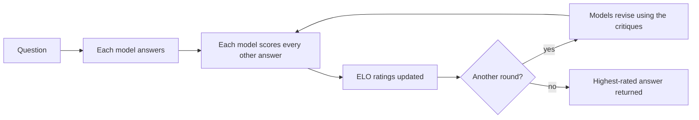
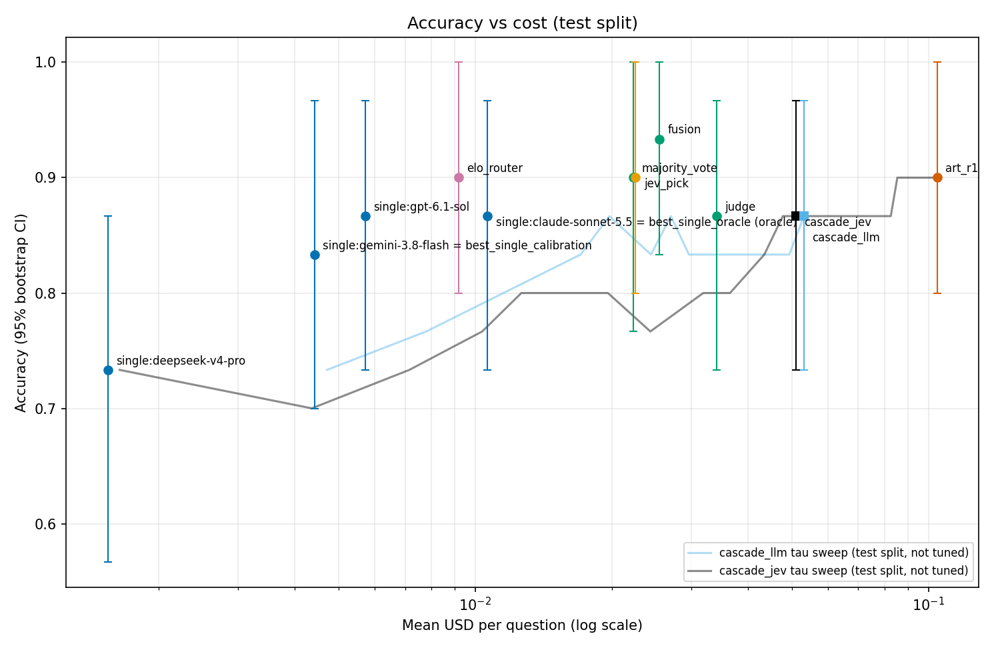

# ART: Adaptive Response Tuning

[](https://python.org/)
[](LICENSE)
[](https://arxiv.org/abs/2512.00617)

ART is a multi-agent framework for improving language-model answers through peer review.
Several models answer the same question, every model scores every other model's answer, the
scores update a multi-agent ELO rating, and the highest-rated answer is returned. Optional
revision rounds let each model improve its answer using the critiques it received.

- Paper: [arXiv:2512.00617](https://arxiv.org/abs/2512.00617)
- Real-model results: [experiments/pilot/published/pilot-v1/](experiments/pilot/published/pilot-v1/)

## How it works



With N models and R rounds, one question costs N + R·N(N−1) + (R−1)·N model calls: N answers,
N(N−1) critiques per round, and N revisions for every round after the first.

## Real-model pilot (October 2026)

The paper's experiments used simulated agents. In October 2026 ART was rerun on four real models
(DeepSeek V4 Pro, Gemini 3.8 Flash, Claude Sonnet 5.5 and GPT-6.1, via OpenRouter) on 50
LAB-Bench questions (SeqQA and ProtocolQA: 20 calibration, 30 test), against nine baselines.

- One round of full peer critique matched majority vote (0.900) at 4.7× the cost.
- ART's ratings, reused as a label-free router fitted on the calibration questions, also scored
  0.900 at $0.009 per question, under a tenth of ART's cost.
- Fusion with a synthesizer scored highest (0.933).
- With 30 test questions, none of these differences is statistically significant.

Test split, 30 questions (`art_r1` is one round of ART; `elo_router` sends each question to the
model with the top ART rating for its subset):

| method | accuracy [95% CI] | $ per question |
|---|---|---|
| single:deepseek-v4-pro | 0.733 [0.567, 0.867] | 0.0015 |
| single:gemini-3.8-flash | 0.833 [0.700, 0.967] | 0.0044 |
| single:claude-sonnet-5.5 | 0.867 [0.733, 0.967] | 0.0106 |
| single:gpt-6.1-sol | 0.867 [0.733, 0.967] | 0.0057 |
| majority_vote | 0.900 [0.767, 1.000] | 0.0223 |
| art_r1 | 0.900 [0.800, 1.000] | 0.1045 |
| judge | 0.867 [0.733, 0.967] | 0.0341 |
| fusion | 0.933 [0.833, 1.000] | 0.0255 |
| elo_router | 0.900 [0.800, 1.000] | 0.0092 |
| best_single_calibration | 0.833 [0.700, 0.967] | 0.0044 |
| best_single_oracle | 0.867 [0.733, 0.967] | 0.0106 |
| jev_pick | 0.900 [0.800, 1.000] | 0.0226 |
| cascade_llm | 0.867 [0.733, 0.967] | 0.0531 |
| cascade_jev | 0.867 [0.733, 0.967] | 0.0509 |



To reproduce the pilot (the run makes real OpenRouter calls unless they are already in the
local cache; see [experiments/pilot/README.md](experiments/pilot/README.md)):

```bash
pip install -e ".[dev]" pandas pyarrow matplotlib pyyaml
echo 'OPENROUTER_API_KEY=sk-or-...' > experiments/pilot/.env   # gitignored

FLAGS="--subsets SeqQA,ProtocolQA --test-per-subset 15 --skip-methods art_r2"
python -m experiments.pilot.run --prepare-data                              # LAB-Bench at the pinned commit
python -m experiments.pilot.run --run-name pilot-v1 $FLAGS --estimate-only  # projected cost, no API calls
python -m experiments.pilot.run --run-name pilot-v1 $FLAGS --max-usd 7.0    # the run
python -m experiments.pilot.publish --run-name pilot-v1                     # shareable results
```

ART is also expressed as [ScreamingFace](https://docs.screamingface.ai) recipes in
[experiments/screamingface/](experiments/screamingface/).

## Installation

Requires Python 3.10 or later.

```bash
git clone https://github.com/OmerJauhar/ART.git
cd ART
python -m venv .venv
source .venv/bin/activate
pip install -e ".[dev]"
```

## Usage

### Python

The example below uses mock agents with fixed quality levels, so it runs without an API key.
Replace them with `LLMAgent` instances to use real models.

```python
import asyncio

from art_framework.agents import AgentConfig, MockAgent
from art_framework.tournament import TournamentConfig, TournamentEngine


async def main() -> None:
    agents = [
        MockAgent(AgentConfig(name="Alpha", model_name="model-a"), response_quality=0.85),
        MockAgent(AgentConfig(name="Beta", model_name="model-b"), response_quality=0.80),
        MockAgent(AgentConfig(name="Gamma", model_name="model-c"), response_quality=0.75),
    ]
    config = TournamentConfig(num_tournaments=1, rounds_per_tournament=3, k_factor=32.0)
    engine = TournamentEngine(agents=agents, config=config)

    result = await engine.run_tournament(
        query="Explain the theory of relativity",
        query_id="example-1",
    )
    print("Winner:", result.winner_agent_id)
    print("Final rankings:", result.final_rankings)


asyncio.run(main())
```

### REST API

Start the server with `python -m art_framework` (or `docker-compose up -d`). Interactive
documentation is served at `http://localhost:8000/docs`.

| Method | Path | Purpose |
|---|---|---|
| GET | `/health`, `/metrics` | Service health and system metrics |
| POST | `/queries` | Submit a question with an optional tournament configuration |
| GET | `/queries/{query_id}`, `/queries` | Retrieve one result or list results |
| POST | `/tournaments` | Run a tournament directly |
| GET | `/tournaments/{tournament_id}`, `/tournaments` | Retrieve one tournament or the history |
| POST, GET, DELETE | `/agents`, `/agents/{agent_id}` | Register, list, inspect and remove agents |
| GET | `/leaderboard` | Current ELO leaderboard |
| POST | `/consensus` | Combine responses with a fusion strategy |
| GET, PUT | `/config` | Read or update the tournament configuration |

### Configuration

Settings are read from environment variables with the `ART_` prefix.

| Variable | Default | Description |
|---|---|---|
| `ART_HOST` | `0.0.0.0` | API host |
| `ART_PORT` | `8000` | API port |
| `ART_DEBUG` | `false` | Debug mode |
| `ART_LOG_LEVEL` | `INFO` | Logging level |
| `ART_OPENAI_API_KEY` | none | API key for OpenAI-compatible endpoints |
| `ART_DEFAULT_MODEL` | `gpt-3.5-turbo` | Default model |
| `ART_DEFAULT_K_FACTOR` | `32.0` | ELO K-factor |

## Repository layout

```
art_framework/
  agents/          LLM and mock agents
  tournament/      Tournament engine and ELO calculator
  consensus/       Fusion strategies
  api/             FastAPI application and routes
  data/            Pydantic models
  utils/           Configuration and logging
experiments/
  pilot/           Real-model pilot harness and published results
  screamingface/   ART as ScreamingFace recipes
tests/             Unit tests
```

## Testing

```bash
pytest
```

## Changes since the paper (v1.0-paper)

The tag `v1.0-paper` marks the code as published with the paper. Since then:

- Temperature 0 is respected instead of being replaced by the default.
- Token usage and cost are tracked per call and per agent.
- The revision prompt includes the original question.
- Unparseable critiques fail loudly instead of defaulting to a score of 70.
- Response confidence comes from peer scores instead of a hardcoded value.
- Revised answers are carried into the next round and re-scored. In v1.0-paper each round
  regenerated fresh answers, so revisions never affected scores or ELO.

## Citation

If you use ART, please cite the paper: [arXiv:2512.00617](https://arxiv.org/abs/2512.00617).

## License

MIT. See [LICENSE](LICENSE).
